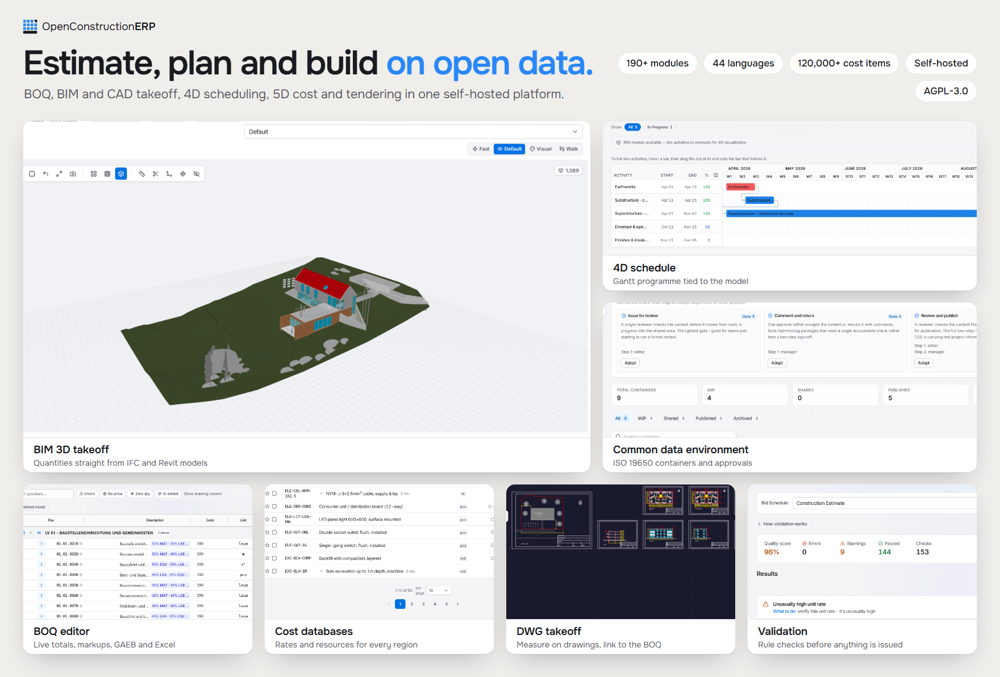

<div align="center">

# OpenConstructionERP

### Kalkulieren, planen und bauen auf offenen Daten.

<picture>
  <source media="(prefers-color-scheme: dark)" srcset="docs/screenshots/hero-dark.png" />
  
</picture>

**Das Open-Source-ERP für das Bauwesen.** LV, BIM- und CAD-Mengenermittlung, 4D-Terminplanung, 5D-Kosten und Ausschreibung in einer selbst gehosteten Plattform. Kostenlos unter AGPL-3.0, keine Lizenzgebühr pro Nutzer, Ihre Daten bleiben auf Ihrem Server.

<a href="https://openconstructionerp.com/download"><b>Desktop-App herunterladen</b></a> · <a href="https://openconstructionerp.com">Live-Demo</a> · <a href="https://openconstructionerp.com/docs">Dokumentation</a> · <a href="https://www.youtube.com/watch?v=X06cIaroAeI">12-Minuten-Rundgang</a>

```bash
pip install --upgrade openconstructionerp && openconstructionerp
```

<sub>Öffnet sich unter http://localhost:8080 mit Demodaten. Kein Docker, keine Datenbank einzurichten. Weitere Wege in der <a href="README.md#quick-start">Schnellstart-Anleitung</a> (Englisch).</sub>

[English](README.md) · [Русский](README.ru.md) · [Selbst erweitern](DEVELOPING.md) · [Community-Chat (Telegram)](https://t.me/datadrivenconstruction) · [Fehler melden](https://github.com/datadrivenconstruction/OpenConstructionERP/issues)

</div>

---

## Was Sie damit tun können

| | |
|---|---|
| **Mengen aus Modellen und Plänen** | Mengen aus IFC- und Revit-Modellen im 3D-Viewer sowie aus DWG- und PDF-Plänen, jede Menge mit dem Bauteil verknüpft. |
| **Preisbildung aus offenen Kostendaten** | Kostendatenbanken für über 40 Märkte mit Preisen und Ressourcen sowie Baugruppen. |
| **Das LV aufbauen** | Ein schneller Editor mit Live-Summen, Zuschlägen und Export nach GAEB XML, Excel und PDF. |
| **In 4D planen** | Ein Balkenplan, der mit dem Modell verknüpft ist. |
| **Vor der Ausgabe prüfen** | Regelsätze (DIN 276, NRM, MasterFormat und mehr) prüfen jede Kalkulation und vergeben eine Qualitätsnote. |
| **Das Projekt steuern** | Dashboards, gemeinsame Datenumgebung, Finanzen und Ausschreibung auf denselben Daten. |

Alle weiteren Abschnitte (Funktionen, Installation, Architektur, Lizenz) stehen in der [englischen README](README.md).
