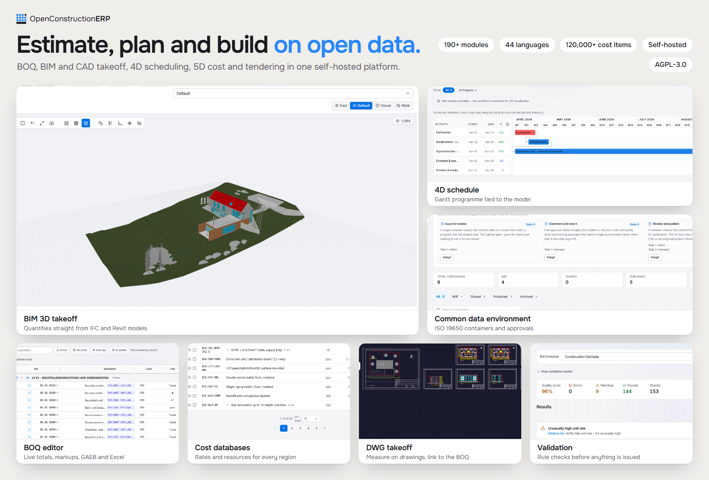

<div align="center">

# OpenConstructionERP

### Считайте, планируйте и стройте на открытых данных.

<picture>
  <source media="(prefers-color-scheme: dark)" srcset="docs/screenshots/hero-dark.png" />
  
</picture>

**Открытая ERP для строительства.** Смета, обмер по BIM и CAD, 4D-планирование, 5D-стоимость и тендеры в одной самостоятельно размещаемой платформе. Бесплатно по лицензии AGPL-3.0, без платы за рабочее место, данные остаются на вашем сервере.

<a href="https://openconstructionerp.com/download"><b>Скачать настольное приложение</b></a> · <a href="https://openconstructionerp.com">Живая демо</a> · <a href="https://openconstructionerp.com/docs">Документация</a> · <a href="https://www.youtube.com/watch?v=X06cIaroAeI">Обзор на 12 минут</a>

```bash
pip install --upgrade openconstructionerp && openconstructionerp
```

<sub>Открывается на http://localhost:8080 с демоданными. Без Docker, без настройки базы данных. Другие способы установки в <a href="README.md#quick-start">кратком руководстве</a> (на английском).</sub>

[English](README.md) · [Deutsch](README.de.md) · [Расширяйте платформу](DEVELOPING.md) · [Чат сообщества (Telegram)](https://t.me/datadrivenconstruction) · [Сообщить об ошибке](https://github.com/datadrivenconstruction/OpenConstructionERP/issues)

</div>

---

## Что можно делать

| | |
|---|---|
| **Обмер по моделям и чертежам** | Объёмы из моделей IFC и Revit в 3D-просмотрщике и из чертежей DWG и PDF, каждый объём связан с элементом. |
| **Расценки из открытых баз** | Базы стоимости для более чем 40 рынков с расценками и ресурсами, плюс сборки. |
| **Собрать смету** | Быстрый редактор с живыми итогами, наценками и экспортом в GAEB XML, Excel и PDF. |
| **Планировать в 4D** | Диаграмма Ганта, связанная с моделью. |
| **Проверять до выпуска** | Наборы правил (DIN 276, NRM, MasterFormat и другие) проверяют каждую смету и ставят оценку качества. |
| **Вести проект** | Дашборды, среда общих данных, финансы и тендеры на одних и тех же данных. |

Остальные разделы (возможности, установка, архитектура, лицензия) смотрите в [английском README](README.md).
